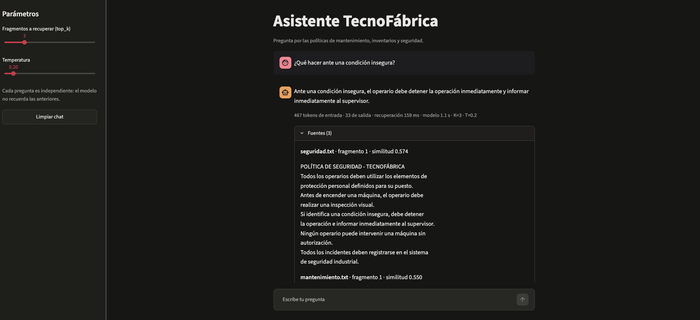
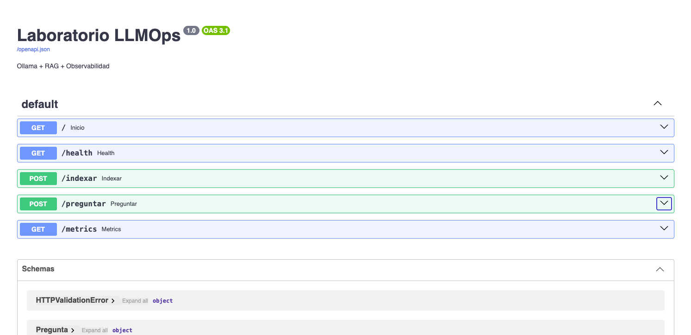
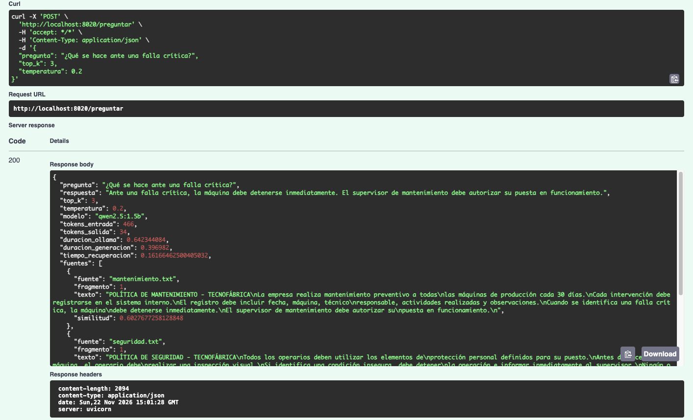
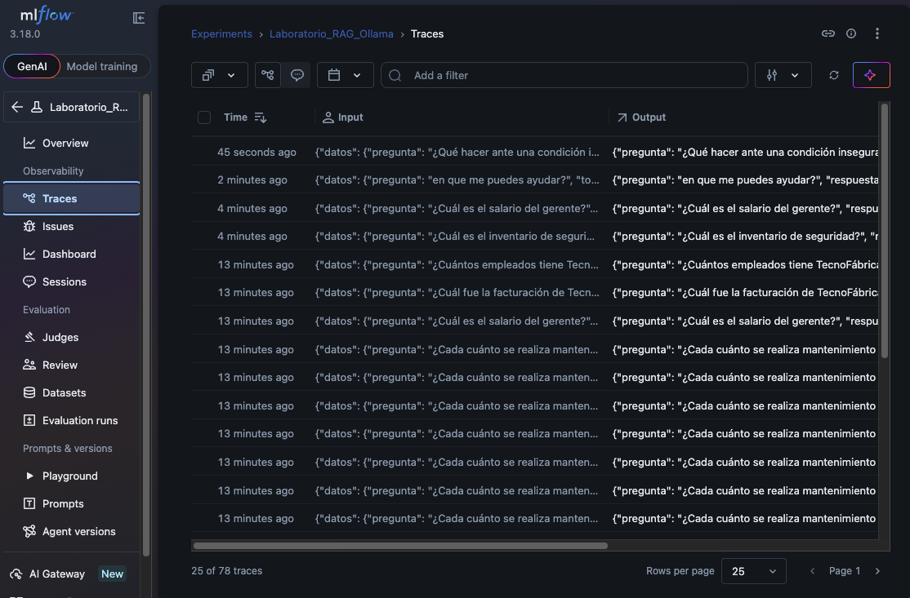
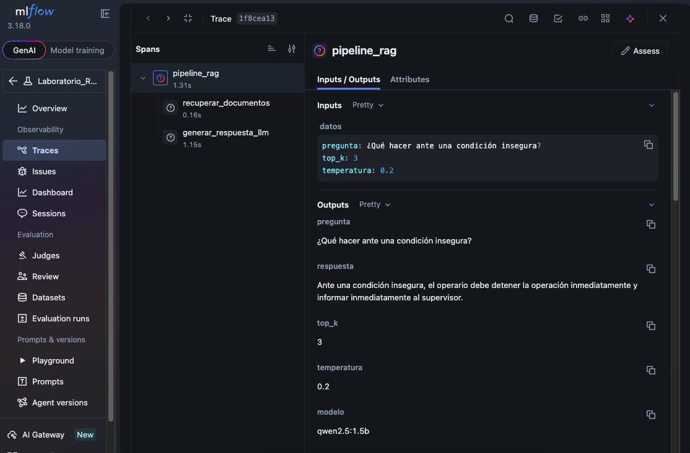
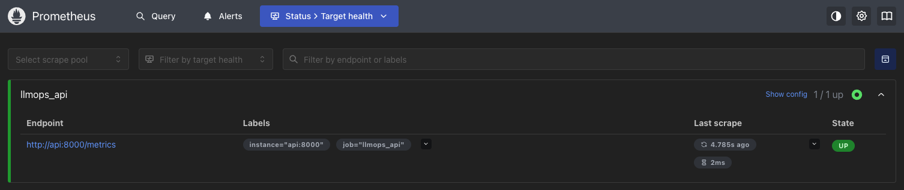
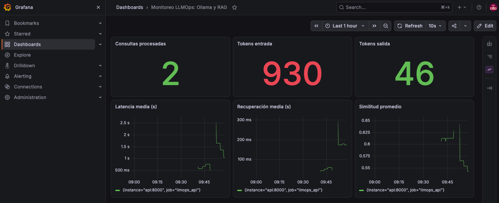

# Laboratorio LLMOps

Asistente RAG local para consultar las políticas de TecnoFábrica, una empresa ficticia.
Los modelos corren en Ollama, sin llamar a ningún proveedor externo: `qwen2.5:1.5b`
responde y `nomic-embed-text` genera los embeddings. Cada consulta queda trazada en
MLflow, y Prometheus y Grafana muestran sus tokens, latencia y similitud. Son seis
contenedores en Docker Compose, contando un chat en Streamlit.

Basado en el tutorial de Juan Manuel Núñez Velasco en Medium. El tutorial está escrito
para Windows con WSL2; este proyecto corre en macOS con Docker Desktop.

## Evidencias

### Chat en Streamlit

La respuesta sale de la política de seguridad, que es la primera fuente recuperada
(similitud 0.574). Debajo aparecen los tokens y los tiempos de la consulta.



### API

Los cinco endpoints en Swagger. `/indexar` corre el pipeline y `/preguntar` responde con el RAG.



Una consulta a `/preguntar` con su respuesta (código 200), los tokens, los tiempos y las
fuentes. La primera fuente es la política de mantenimiento (similitud 0.603).



### Trazas en MLflow

Lista del experimento `Laboratorio_RAG_Ollama`. Tiene 78 trazas, más que las 24 de
[Resultados](#resultados), porque hubo más consultas después de la evaluación.



Dentro de una traza, `pipeline_rag` (1,31 s) se reparte entre `recuperar_documentos`
(0,16 s) y `generar_respuesta_llm` (1,15 s). Es la misma consulta de la captura del chat.



### Prometheus

El target `llmops_api` está en estado `UP`: Prometheus lee `/metrics` de la API.



### Grafana

Los tres contadores muestran solo 2 consultas (930 tokens de entrada, 46 de salida) porque
viven en la memoria de la API y vuelven a cero cuando se reinicia; MLflow sí conserva el
historial. Las curvas de abajo son promedios de los últimos 5 minutos y el hueco corresponde
a un periodo sin consultas.



## Arquitectura

Los documentos pasan por un pipeline medallion (bronze, silver, gold) que termina en una
base SQLite. La API busca en esa base los fragmentos para responder:

```
documentos/ ──► bronze ──► silver ──► gold ──► data/gold/indice.db
                copia      limpieza   fragmentos,     │
                exacta                embeddings      │
                                                      ▼
Streamlit ─► API FastAPI ──► recuperar_documentos ──► similitud coseno
                 │                  │                 (embedding de la pregunta: nomic-embed-text)
                 │                  ▼
                 │           generar_respuesta_llm ──► Ollama: qwen2.5:1.5b
                 │
                 ├── trazas ──► MLflow      (pipeline_rag → recuperar_documentos, generar_respuesta_llm)
                 └── /metrics ◄── Prometheus ◄── Grafana
```

| Servicio | URL | Para qué |
|---|---|---|
| Chat (Streamlit) | http://localhost:8502 | Preguntar y ver la respuesta, los tokens y las fuentes |
| API (Swagger) | http://localhost:8020/docs | `/indexar`, `/preguntar`, `/health`, `/metrics` |
| MLflow | http://localhost:5001 | Trazas del experimento `Laboratorio_RAG_Ollama` |
| Prometheus | http://localhost:9091 | Métricas y consultas PromQL |
| Grafana | http://localhost:3001 | Dashboard *Monitoreo LLMOps: Ollama y RAG* (admin / admin) |
| Ollama | http://localhost:11435 | Modelos locales |

### Capas

| Etapa | Código | Qué hace | Salida |
|---|---|---|---|
| Extract → bronze | `src/extract/extract_documentos.py` | Copia los TXT byte a byte y registra tamaño, SHA-256 y fecha | `data/bronze/*.txt`, `manifiesto.csv` |
| Transform → silver | `src/transform/clean_documentos.py` | Normaliza Unicode, saltos de línea y espacios; descarta documentos vacíos o repetidos | `data/silver/documentos.csv` |
| Transform → gold | `src/transform/fragmentar.py` | Divide en fragmentos de 500 caracteres con solape de 80 | `data/gold/fragmentos.csv` |
| Transform → gold | `src/transform/embeddings.py` | Calcula el embedding de cada fragmento con Ollama | `data/gold/embeddings.json` |
| Load | `src/load/load_indice.py` | Carga documentos y fragmentos en SQLite; si algo falla, queda el índice anterior | `data/gold/indice.db` |

### Estructura

```
main.py                        pipeline completo: extract → transform → load
config/config.yaml             rutas, tamaño de fragmento y modelo de embeddings
documentos/                    políticas de TecnoFábrica (fuente)
src/                           extract/, transform/, load/
data/                          bronze/, silver/, gold/
app/                           API FastAPI y cliente de terminal
ui/                            chat en Streamlit
evaluacion/                    preguntas, scripts y resultados publicados
tests/                         extract, transform, calidad de datos y RAG
logs/                          pipeline.log
mlflow/ prometheus/ grafana/   servicios de observabilidad
```

La evaluación va aparte del pipeline para que las preguntas de referencia no entren al
índice.

## Uso

Requiere Docker Desktop abierto y [uv](https://github.com/astral-sh/uv) para el entorno
de los scripts de evaluación.

```bash
make all           # primera vez: levanta todo, descarga los modelos (~1,3 GB), corre el pipeline, pregunta y abre el navegador
make up            # levanta los seis servicios
make pipeline      # documentos/ -> bronze -> silver -> gold -> SQLite (al cambiar los documentos)
make ask Q="¿Cuál es el inventario de seguridad?" K=3 T=0.2
make eval          # 8 preguntas de referencia -> evaluacion/resultados/evaluacion.json
make experimentos  # top_k, temperatura y preguntas sin evidencia -> evaluacion/resultados/experimento_*.json
make status        # estado de cada servicio
make down          # apaga todo; los modelos, trazas y métricas se conservan
make help          # todos los comandos
```

El chat queda en http://localhost:8502. Cada pregunta se responde por separado: el
historial se ve en pantalla, pero no se envía al modelo.

`make ask` muestra la respuesta, los tokens, los tiempos y las fuentes recuperadas:

```
  Pregunta:  ¿Cada cuánto se realiza el mantenimiento preventivo?
  Respuesta: Cada 30 días se realiza el mantenimiento preventivo a todas las máquinas de producción en la empresa.

  tokens entrada=470  salida=26  ollama=2.32s  recuperación=0.018s
  fuente: mantenimiento.txt#1  similitud=0.725
  fuente: seguridad.txt#1  similitud=0.650
  fuente: inventarios.txt#1  similitud=0.564
```

## Resultados

Todos los datos de esta sección salen de `evaluacion/resultados/`.
Ollama corre en CPU dentro de Docker (`ollama ps` muestra `100% CPU`). Con el modelo ya
cargado, las respuestas de la evaluación tardaron entre 0,2 y 0,8 s.

### Evaluación con preguntas de referencia

Revisé a mano las 8 respuestas contra las políticas: las 8 son correctas.

| # | Pregunta | Esperada | Generada | Tokens entrada / salida |
|---|---|---|---|---|
| 1 | ¿Cada cuánto se realiza mantenimiento preventivo? | Cada 30 días | Se realiza mantenimiento preventivo a todas las máquinas de producción cada 30 días. | 469 / 21 |
| 2 | ¿Cuál es el nivel mínimo de inventario? | 100 unidades por referencia | El nivel mínimo de inventario de materia prima es de 100 unidades por referencia. | 467 / 20 |
| 3 | ¿Cuál es el inventario de seguridad? | 50 unidades por referencia | El inventario de seguridad de la empresa TecnoFabrica corresponde a 50 unidades por referencia. | 466 / 23 |
| 4 | ¿Qué se hace ante una falla crítica? | Detener la máquina inmediatamente | Ante una falla crítica, la máquina debe detenerse inmediatamente. Posteriormente, el supervisor de mantenimiento debe autorizar su puesta en funcionamiento. | 466 / 38 |
| 5 | ¿Quién autoriza la puesta en funcionamiento? | El supervisor de mantenimiento | El supervisor de mantenimiento autoriza la puesta en funcionamiento de las máquinas. | 468 / 20 |
| 6 | ¿Qué hacer ante una condición insegura? | Detener la operación e informar al supervisor | Ante una condición insegura, el operario debe detener la operación inmediatamente y informar inmediatamente al supervisor. | 467 / 33 |
| 7 | ¿Quién verifica los movimientos de inventario? | El responsable de almacén | El responsable de almacén debe verificar diariamente los movimientos de inventario. | 467 / 19 |
| 8 | ¿Cuál es el salario del gerente? | No existe información suficiente | No existe información sobre el salario del gerente en el contexto proporcionado. | 466 / 16 |

### Experimento A: top_k

Pregunta: *¿Qué debe hacer un operario si encuentra una condición insegura?*

| Indicador | K = 1 | K = 3 | K = 5 |
|---|---|---|---|
| Tokens de entrada | 220 | 472 | 472 |
| Tokens de salida | 35 | 31 | 35 |
| Similitud máxima | 0.654 | 0.654 | 0.654 |
| Fuentes | seguridad.txt | las 3 | las 3 |
| Respuesta correcta | Sí | Sí | Sí |

Con K = 1 la respuesta es igual de correcta y usa menos de la mitad de los tokens de
entrada. K = 3 y K = 5 recuperan lo mismo porque el índice solo tiene **3 fragmentos**: cada
documento mide menos de 500 caracteres, el tamaño de fragmento, así que no se divide.

### Experimento B: temperatura

Pregunta: *¿Cada cuánto se realiza mantenimiento preventivo?*, 3 repeticiones por valor.

- **T = 0**: las tres respuestas son idénticas, palabra por palabra.
- **T = 0,5**: dos redacciones distintas.
- **T = 1**: tres redacciones distintas; una se acorta a "Se realiza mantenimiento
  preventivo cada 30 días." (13 tokens frente a 21).

Las 9 respuestas dicen "cada 30 días"; con la temperatura variaron la redacción y la
longitud, de 13 a 22 tokens de salida.

### Experimento C: preguntas sin evidencia

| Pregunta | Similitud máxima | Respuesta |
|---|---|---|
| ¿Cuál es el salario del gerente? | 0.500 | No existe información sobre el salario del gerente en el contexto proporcionado. |
| ¿Cuál fue la facturación de TecnoFábrica el año pasado? | 0.648 | No existe información en el contexto proporcionado sobre la facturación… |
| ¿Cuántos empleados tiene TecnoFábrica? | 0.663 | No existe información en el contexto proporcionado sobre el número de empleados… |

El modelo no inventó ningún dato. Aun así, la pregunta de empleados obtuvo una similitud
de 0.663, casi igual que una pregunta con respuesta (0.654 en el experimento A): en
este índice, la similitud por sí sola no habría servido para detectar que faltaba la
respuesta.

### Trazas y métricas

Cada consulta genera en MLflow una traza `pipeline_rag` con dos spans hijos,
`recuperar_documentos` y `generar_respuesta_llm`. Tras la evaluación y los experimentos,
MLflow tenía 24 trazas y Prometheus registraba 24 consultas, 11.002 tokens de entrada y
566 de salida. En las 24 trazas la generación (de 126 ms a 2,3 s) tarda más que la
recuperación (de 14 a 110 ms); la consulta más lenta fue la primera, con el modelo
cargándose en memoria.

## Tests

```bash
make test
```

Los 18 tests cubren la copia a bronze, la limpieza, la división en fragmentos, la calidad
de cada capa (nulos, duplicados, tamaños), la carga del índice y la similitud coseno. Usan
embeddings simulados, así que no necesitan Ollama. El CI de GitHub Actions valida el
`docker-compose.yml` y corre los mismos tests.

## Cambios respecto al tutorial

- **macOS en vez de Windows + WSL2.** Docker Desktop ya trae la VM Linux, así que los
  pasos 2 y 3 no aplican.
- **Chat en Streamlit** (`ui/`), que consulta la API; el tutorial solo usa Swagger. Está en
  el puerto 8502 porque el 8501 lo ocupa otro proyecto (`UI_PORT` en `.env`).
- **Puertos 8020, 5001, 9091, 3001 y 11435** en vez de 8000, 5000, 9090, 3000 y 11434:
  en mi equipo estaban ocupados por otros proyectos, por AirPlay (5000) y por Ollama
  nativo (11434). Se cambian en `.env`; `--allowed-hosts` de MLflow usa el mismo puerto.
- **Pipeline medallion.** El tutorial lee los TXT y escribe `datos/indice.json` en una sola
  función; aquí son etapas separadas y la API consulta SQLite. Los 3 fragmentos y
  sus embeddings coinciden con los del índice anterior.
- **Dashboard de Grafana precargado** con los seis paneles del paso 27, en
  `grafana/provisioning/dashboards/`.
- **`evaluacion/experimentos.py`** ejecuta los experimentos A, B y C del paso 30 y guarda los
  resultados, en lugar de llenar las tablas a mano.
- **`app/cliente.py`** formatea las respuestas en la terminal para `make index` y `make ask`.
- **`evaluacion/evaluacion.py`** lee la URL de la API de la variable `API_URL`.
- **`pytest`** agregado a `requirements.txt` para correr los tests dentro del contenedor, junto con
  `pandas` y `pyyaml` para el pipeline.
